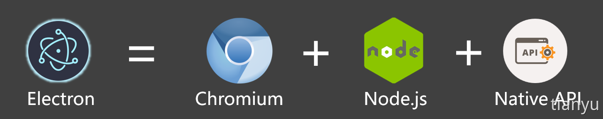
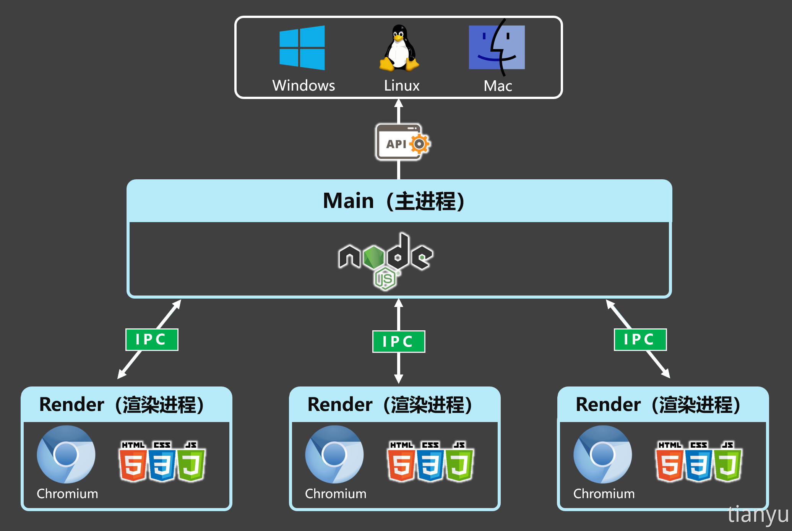
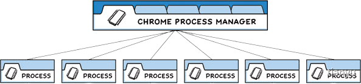

# Electron快速上手

https://www.yuque.com/tianyu-coder/openshare/electron#dqi3I

## Electron是什么？

[**Electron** ](https://www.electronjs.org/zh/)是一个**跨平台桌面应用**开发框架，开发者可以使用：HTML、CSS、JavaScript 等 Web 技术来构建跨平台的桌面应用程序（Windows/MacOS/Linux），它的本质是结合了 **Chromium** 和 **Node.js**，现在广泛用于桌面应用程序开发，例如这些桌面应用都用到了Electron：VSCode、GitHubDesktop、1Password、QQ桌面版...

## Electron 的优势

1. **可跨平台**：同一套代码可以构建出能在：Windows、macOS、Linux 上运行的应用程序。
2. **上手容易**：使用 Web 技术就可以轻松完成开发桌面应用程序。
3. **底层权限**：允许应用程序访问文件系统、操作系统等底层功能，从而实现复杂的系统交互。
4. **社区支持**：拥有一个庞大且活跃的社区，开发者可以轻松找到文档、教程和开源库。

## Electron 技术架构

- ### 技术架构

  

  Electron本质是，结合了Chrome的内核Chrominum、Nodejs、以及Electron提供的一些用于操作原生环境的Native API。

- ### 进程模型

  

  Electron应用的核心就是围绕着主进程（Main），它就是一个跑在Nodejs环境中的js脚本。主进程是用来管理所有的渲染进程（Render）的，主进程和渲染进程之间通过IPC来进行双向通信。渲染进程之间要想通信，必须经过主进程。因此Electron是一个多进程的应用。
  
  主进程通过调用Electron提供的一套Native API可以对不同系统进行操作，一套代码就可以打包到不同环境上运行。

## 搭建一个最基础的Electron工程

1. 使用npm初始化一个node工程目录`npm init`，然后填写好`package.json`中的必要信息及启动命令。

   ```json
   {
     "name": "test",
     "version": "1.0.0",
     "main": "main.js", // electron项目的入口
     "scripts": {
       "start": "electron ." //start命令用于启动整个应用
     },
     "author": "tianyu", //为后续能顺利打包，此处要写明作者。
     "license": "ISC",
     "description": "this is a electron demo", //为后续能顺利打包，此处要编写描述。
   }
   ```

   有几条规则需要遵循：

   - *入口点* 应当是 `main.js`
   - *author*、*license* 和 *description* 可以填任何值，但是不能为空，它们对于稍后的打包步骤是*必填*项。

2. 安装`electron`作为开发依赖：`npm i electron -D`

   > 为什么 Electron 是开发依赖？
   >
   > 您的应用需要运行 Electron API，因此这听上去可能有点反直觉。 在底层实现中，Electron 的 JavaScript API 绑定到了一个包含其实现的二进制文件上。 Electron 的打包步骤负责处理对这个二进制文件的捆绑工作，因此无需将它指定为生产依赖。

3. 在`main.js`中编写代码，创建一个基本窗口。

   ```js
   /* 
     main.js运行在应用的主进程上，无法访问Web相关API，主要负责：控制生命周期、显示界面、控制渲染进程等其他操作。
   */
   const { app, BrowserWindow } = require('electron')
   
   // 用于创建窗口
   function createWindow() {
     const win = new BrowserWindow({
       width: 800, // 窗口宽度
       height: 600, // 窗口高度
       autoHideMenuBar: true, // 自动隐藏菜单栏
       alwaysOnTop: true, // 置顶
       x: 0, // 窗口位置x坐标
       y: 0 // 窗口位置y坐标
     })
     // 加载一个远程页面
     win.loadURL('http://www.atguigu.com')
   }
   
   // 当app准备好后，执行createWindow创建窗口
   app.on('ready',()=>{
     createWindow()
   })
   ```

   > 关于 BrowserWindow 的更多配置项，请参考：[BrowserWindow实例属性](https://www.electronjs.org/zh/docs/latest/api/browser-window)

4. 启动应用：`npm start`，你应该看到如下页面。

   todo

## 加载本地页面

1. 创建`pages/index.html`编写内容：

   ```html
   <!DOCTYPE html>
   <html>
     <head>
       <meta charset="UTF-8" />
       <title>index</title>
     </head>
     <body>
       <h1>你好啊！</h1>
     </body>
   </html>
   ```

2. 修改`mian.js`加载本地页面：

   ```js
   // 加载一个本地页面
   win.loadFile('./pages/index.html')
   ```

3. 配置CSP：

   此时开发者工具会报出一个安全警告，需要修改`index.html`，配置 CSP(Content-Security-Policy)

   ```html
   <meta http-equiv="Content-Security-Policy" content="default-src 'self'; style-src 'self' 'unsafe-inline'; img-src 'self' data:;">
   ```

   > 上述配置的说明：
   >
   > 1. `default-src 'self'`：
   >    - `default-src`：配置加载策略，适用于所有未在其它指令中明确指定的资源类型。
   >    - `self`：仅允许从同源的资源加载，禁止从不受信任的外部来源加载，提高安全性。
   > 2. `style-src 'self' 'unsafe-inline'`：
   >    - `style-src`：指定样式表（CSS）的加载策略。
   >    - `self`：仅允许从同源的资源加载，禁止从不受信任的外部来源加载，提高安全性。
   >    - `unsafe-inline`：允许在HTML文档内使用内联样式。
   > 3. `img-src 'self' data:`：
   >    - `img-src`：指定图像资源的加载策略。
   >    - `self`：表示仅允许从同源加载图像。
   >    - `data:`：允许使用 `dataURI` 来嵌入图像。这种URI模式允许将图像数据直接嵌入到HTML或CSS中，而不是通过外部链接引用。
   >
   > **关于 CSP 的详细说明请参考：**[MDN-Content-Security-Policy](https://developer.mozilla.org/zh-CN/docs/Web/HTTP/Headers/Content-Security-Policy)、[Electron Security](https://www.electronjs.org/docs/latest/tutorial/security)

## 完善窗口行为

Windows 和 Linux 平台窗口特点是：关闭所有窗口时退出应用。

```js
// 当所有窗口都关闭时
app.on('window-all-closed', () => {
  // 如果所处平台不是mac(darwin)，则退出应用。
  if (process.platform !== 'darwin') app.quit()
})
```

mac 应用即使在没有任何窗口的情况下也会继续运行，并且在没有窗口可用的情况下激活应用时会打开新的窗口。

```js
// 当app准备好后，执行createWindow创建窗口
app.on('ready',()=>{
  createWindow()
  // 当应用被激活时
  app.on('activate', () => {
    //如果当前应用没有窗口，则创建一个新的窗口
    if (BrowserWindow.getAllWindows().length === 0) createWindow()
  })
})
```

## 配置自动重启

1. 安装 Nodemon：`npm i nodemon -D`

2. 修改 package.json 命令：

   ```json
   "scripts": {
     "start": "nodemon --exec electron ."
   },
   ```

3. 配置 nodemon.json 规则：

   ```josn
   {
     "ignore": [
       "node_modules",
       "dist"
     ],
     "restartable": "r",
     "watch": ["*.*"],
     "ext": "html,js,css"
   }
   ```

   配置好以后，当代码修改后，应用就会自动重启了。

## 主进程与渲染进程

下图是 Chrome 浏览器的程序架构，图来自于[Chrome 漫画](https://www.google.com/googlebooks/chrome/)。



Electron 应用的结构与上图非常相似，在 Electron 中主要控制两类进程：主进程、渲染器进程。

- ### 主进程

  每个 Electron 应用都有一个单一的主进程，作为应用程序的入口点。 主进程在 Node.js 环境中运行，它具有 require 模块和使用所有 Node.js API 的能力，主进程的核心就是：**使用 BrowserWindow 来创建和管理窗口。**

- ### 渲染进程

  每个 BrowserWindow 实例都对应一个单独的渲染器进程，运行在渲染器进程中的代码，必须遵守网页标准，这也就意味着：**渲染器进程无权直接访问 `require` 或使用任何Node.js的API**。

  > 问题产生：处于渲染器进程的用户界面，该怎样才与 **Node.js** 和 **Electron** 的原生桌面功能进行交互呢？

