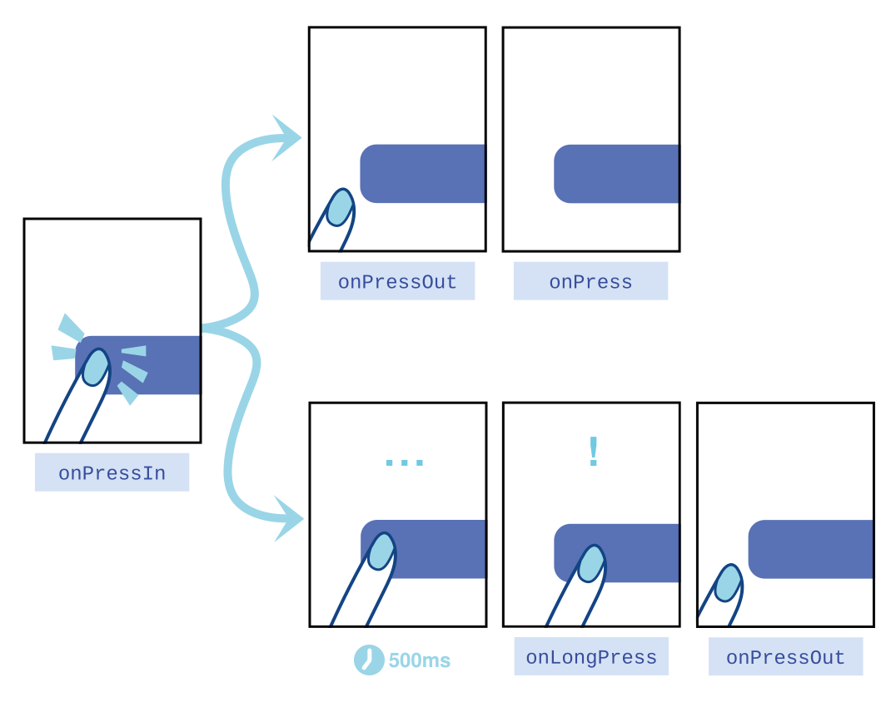
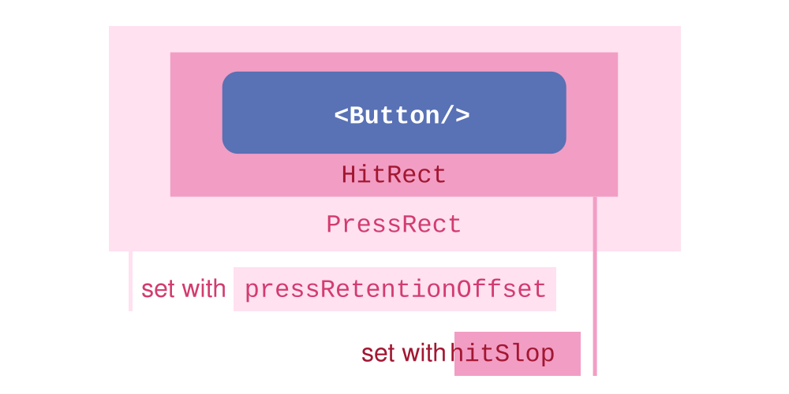

### RN中的核心组件

React Native 中的核心组件，是对（安卓/iOS）原生组件的封装。核心组件又可以分为：

- [基础组件](https://reactnative.cn/docs/components-and-apis#基础组件)
- [交互控件](https://reactnative.cn/docs/components-and-apis#交互控件)
- [列表视图](https://reactnative.cn/docs/components-and-apis#列表视图)
- [Android 独有组件](https://reactnative.cn/docs/components-and-apis#android-独有的组件和-api)
- [iOS 独有组件](https://reactnative.cn/docs/components-and-apis#ios-独有的组件和-api)
- [其他](https://reactnative.cn/docs/components-and-apis#其他)

需要说明的是，你不会被局限在这些内置组件上。React Native 有一个由数千名开发者组成的庞大社区。如果你正在寻找某个特定功能的库，请参阅[查找第三方库](https://reactnative.cn/docs/libraries#搜索第三方库)的指南。

- `<Button>`：一个简单的跨平台按钮组件。它有以下两个**必需的**Props：

  - `title`：按钮内显示的文本。在 Android 上，给定的标题会被转换为大写形式。

  - `onPress`：当用户点击按钮时调用的处理函数。

- `<Switch>`：一个跨平台通用的“开关”组件。注意这是一个“受控组件”（controlled component）。你必须使用`onValueChange`回调来更新`value`属性以响应用户的操作。如果不更新`value`属性，组件只会按一开始给定的`value`值来渲染且保持不变，看上去就像完全点不动。

  - `value`：表示此开关是否打开。默认为 false（关闭状态）。

  - `onValueChange`：当值改变的时候调用此回调函数，参数为新的值。如果你想接收一个完整事件，请使用 `onChange`。

  - `onChange`：当值改变的时候调用此回调函数，参数为事件。如果你只想接收新值，请改用 `onValueChange`。

  - `thumbColor`：开关上圆形按钮的背景颜色。在 iOS 上设置此颜色会丢失按钮的投影效果。值是一个颜色字符串。

  - `trackColor`：关闭状态时的边框颜色(iOS)或背景颜色(Android)。值是一个对象：`object: {false: color_string, true: color_string}`。

    > **iOS**: 当开关值为 `false` 时，轨道会收缩到边框内。如果你想改变收缩后轨道露出的背景颜色，请使用 [`ios_backgroundColor`](https://reactnative.cn/docs/switch#ios_backgroundColor)。

- `<StatusBar>`：用于控制应用状态栏的组件。状态栏是屏幕顶部的区域，通常显示当前时间、Wi-Fi 和蜂窝网络信息、电池电量和/或其他状态图标。

  - `hidden`：是否隐藏状态栏。默认false。

  - `barStyle`：设置状态栏文本的颜色。在 Android 上，此属性仅对 API 23 及以上版本生效。

    它的值是一个`StatusBarStyle`类型的枚举：

    | 值                | 类型   | 描述                                         |
    | ----------------- | ------ | -------------------------------------------- |
    | `'default'`       | string | 默认状态栏样式（iOS 为深色，Android 为浅色） |
    | `'light-content'` | string | 白色文字和图标                               |
    | `'dark-content'`  | string | 深色文字和图标（Android 上需要 API>=23）     |

- `<ActivityIndicator>`：显示一个圆形的加载指示器。

  - `animating`：是否显示指示器动画。`true` 表示显示，`false` 表示隐藏。

  - `color`：滚轮的前景颜色。默认安卓是`null`（系统默认强调色）、iOS是`'#999999'`。

  - `size`：指示器的大小，默认为 `'small'`，还有一个值是`'large'`。

    > 目前只能在 Android 上设定具体的数值。

- `<Image>`：用于显示多种不同类型图片的组件，包括网络图片、静态资源、临时本地图片、以及本地磁盘上的图片（如相册）。

  > 注意：对于网络图片和 `'data:'` URI 形式提供的 图片，你需要手动指定图片的尺寸！

  - `style`：样式对象、或样式对象数组。

  - `source`：图片源（远程 URL 或本地文件资源）。

    该属性还可以包含多个远程 URL，并为它们指定宽高以及比例等 URI 参数。原生端会根据图片容器的测量尺寸选择最佳的 `uri`。可以添加 `cache` 属性控制网络请求与本地缓存的交互（更多信息参见[图片缓存控制](https://reactnative.cn/docs/images#cache-control)）。

    目前支持的格式有 `png`、`jpg`、`jpeg`、`bmp`、`gif`、`webp`、`psd`（仅 iOS）。此外 iOS 还支持若干 RAW 格式。请查阅 Apple 文档了解当前支持的相机型号（iOS 12 参见 https://support.apple.com/en-ca/HT208967）。

    请注意：`webp` 格式在 iOS 上仅在与 JavaScript 代码一起打包时才受支持。

    `source`的值为`ImageSource`，一个对象、对象数组、或数字。

    **当以对象或对象数组形式传入时的属性：**

    | 名称          | 类型                                                         | 说明                                                         |
    | ------------- | ------------------------------------------------------------ | ------------------------------------------------------------ |
    | uri           | string                                                       | 图片资源标识符，可以是 http 地址、本地文件路径或静态图片资源的名称。 |
    | width         | number                                                       | 若在构建时已知，可以指定该值并作为 `<Image/>` 组件的默认宽度。 |
    | height        | number                                                       | 若在构建时已知，可以指定该值并作为 `<Image/>` 组件的默认高度。 |
    | scale         | number                                                       | 指示图片的缩放因子。默认为 `1.0`，表示一个图片像素等于一个显示点/DIP。 |
    | bundle（iOS） | string                                                       | 图片所在的 iOS 资源 bundle，若不设置则默认为 `[NSBundle mainBundle]`。 |
    | method        | string                                                       | 使用的 HTTP 方法，未指定时默认为 `'GET'`。                   |
    | headers       | object                                                       | 随远程图片请求发送的 HTTP 头对象。                           |
    | body          | string                                                       | 随请求发送的 HTTP body。必须是有效的 UTF-8 字符串，会原样发送，不会做额外编码（如 URL 转义或 base64）。 |
    | cache（iOS）  | [ImageCacheEnum](https://reactnative.cn/docs/image#imagecacheenum-ios) | 决定请求如何处理可能的缓存响应。                             |

    **当以 number 传入时：**（常用）

    - `number`：类似 `require('./image.jpg')` 返回的不透明类型。

  - `src`：图片远程 URL 的字符串。优先级高于 `source`。

    **示例：** `src={'https://reactnative.dev/img/tiny_logo.png'}`

- `<TextInput>`：TextInput 是一个允许用户在应用中通过键盘输入文本的基础组件。通过不同的属性，你可以配置自动更正、自动大小写、占位文字，以及数字键盘等不同键盘类型。

  - `value`：要在输入框中显示的值（string）。

    `TextInput` 是一个受控组件，这意味着如果提供了 `value`，原生输入框的内容会被强制与该值保持一致。大多数情况下这都很好用，但在某些场景下可能会导致闪烁——常见原因是通过保持 `value` 不变来阻止用户编辑。除了维持同样的 `value` 之外，更好的做法是将 `editable` 设为 `false`，或者设置/更新 `maxLength` 来避免不希望的编辑，同时不产生闪烁。

  - `editable`：如果为 false，文本框是不可编辑的。默认值为 true。

  - `maxLength`：限制文本框中最多的字符数（number）。使用这个属性而不用 JS 逻辑去实现，可以避免闪烁的现象。

  - `multiline`：如果为 true，文本框中可以输入多行文字。默认值为 false。该属性可以配合`numberOfLines`来生成文本域。

    > 需要注意的是，此属性在 iOS 上会使文字顶部对齐，而在 Android 上会使文字垂直居中。如需在两个平台上保持一致的行为，可将 `textAlignVertical` 属性设为 `'top'`。

  - `numberOfLines`：设置 `TextInput` 的最大行数。通常配合 `multiline={true}` 一起使用，以便填满指定的行数。

    > `numberOfLines` 在 iOS 上仅在[新架构](https://reactnative.cn/architecture/landing-page)中可用。

  - `placeholder`：在尚未输入任何文字之前显示的占位字符串（string）。

  - `secureTextEntry`：如果为 true，文本框会遮住之前输入的文字，这样类似密码之类的敏感文字可以更加安全。默认值为 false。`multiline={true}`时不可用。

  - `keyboardType`：决定弹出何种软键盘类型，譬如`numeric`（纯数字键盘）。

    ```tex
    enum('default', 'email-address', 'numeric', 'phone-pad', 'ascii-capable', 'numbers-and-punctuation', 'url', 'number-pad', 'name-phone-pad', 'decimal-pad', 'twitter', 'web-search', 'visible-password')
    ```

    所有键盘类型的示意图可参考这里：[链接](https://davidl.fr/blog/keyboard-react-native-ios-android#all-react-native-keyboard-type-examples-i-os-on-the-left-android-on-the-right)。

    这些值在所有平台都可用：

    - `default`
    - `number-pad`
    - `decimal-pad`
    - `numeric`
    - `email-address`
    - `phone-pad`
    - `url`

    （*iOS Only*）下面的值仅 iOS 可用：

    - `ascii-capable`
    - `numbers-and-punctuation`
    - `name-phone-pad`
    - `twitter`
    - `web-search`

    （*Android Only*）下面的值仅 Android 可用：

    - `visible-password`

  - `onChangeText`：当文本框内容变化时调用此回调函数。改变后的文字内容会作为参数传递。

- `Touchable`组件：

  > 我们建议使用[Pressable](https://reactnative.cn/docs/pressable)组件来代替`Touchable`组件，它更具扩展性且会是官方未来力推的主流。

  - `<TouchableHighlight>`：该组件用于封装视图，使其可以正确响应触摸操作。当按下的时候，封装的视图的不透明度会降低，同时会有一个底层的颜色透过而被用户看到，使得视图变暗或变亮。

    在底层实现上，实际会创建一个新的视图到视图层级中，如果使用的方法不正确，有时候会导致一些不希望出现的视觉效果。譬如没有给视图的 backgroundColor 显式声明一个不透明的颜色。

    注意`TouchableHighlight`**只支持一个子节点**（不能没有子节点也不能多于一个）。如果你希望包含多个子组件，可以用一个 View 来包装它们。

  - `<TouchableOpacity>`：该组件用于封装视图，使其可以正确响应触摸操作。当按下的时候，封装的视图的不透明度会降低。

    不透明度的变化是通过把子元素封装在一个 `Animated.View` 中来实现的，这个动画视图会被添加到视图层级中，少数情况下有可能会影响到布局。

  - `<TouchableWithoutFeedback>`：除非有充分的理由，否则不要使用此组件。所有响应按压的元素在被触摸时都应该有视觉反馈。

    `TouchableWithoutFeedback` 仅支持一个子元素。如果你需要多个子组件，请将它们包裹在一个 View 中。重要的是，`TouchableWithoutFeedback` 通过克隆子元素并应用响应器属性来工作。因此，任何中间组件都需要将这些属性传递给底层的 React Native 组件。

  它们都有以下属性：

  - `onPress`：当触摸释放时调用，但如果被取消则不会调用（例如，被滚动视图抢夺了响应器锁定）。第一个函数参数是 [PressEvent](https://reactnative.cn/docs/pressevent) 形式的事件。

- `Pressable`：它是一个RN核心组件的封装，它可以检测到任意子组件的不同阶段的按压交互情况。

  ```tsx
  <Pressable onPress={onPressFunction}>
    <Text>I'm pressable!</Text>
  </Pressable>
  ```

  > 原理：

  在被 `Pressable` 包装的元素上：

  - [`onPressIn`](https://reactnative.cn/docs/pressable#onpressin) 在按压时被调用。
  - [`onPressOut`](https://reactnative.cn/docs/pressable#onpressout) 在按压动作结束后被调用。

  在按下 [`onPressIn`](https://reactnative.cn/docs/pressable#onpressin) 后，将会出现如下两种情况的一种：

  1. 用户移开手指，依次触发 [`onPressOut`](https://reactnative.cn/docs/pressable#onpressout) 和 [`onPress`](https://reactnative.cn/docs/pressable#onpress) 事件。
  2. 按压持续 500 毫秒以上，触发 [`onLongPress`](https://reactnative.cn/docs/pressable#onlongpress) 事件。（[`onPressOut`](https://reactnative.cn/docs/pressable#onpressout) 在移开手后依旧会触发）

  

  手指的精准度终究不是很精确，人们经常会不小心按错了或者错过了触发区域。为了帮助解决这个问题，`Pressable` 提供了一个可选项 `HitRect`，可以用来定义相对于包裹元素的有效触控距离。在 `HitRect` 内的任何地方都可以触发按压动作。

  `PressRect` 在保持激活状态的同时，允许用户按压时在元素及设定的范围内滑动，使触控更加优雅。试想一下缓慢地滑动着离开按下的按钮。

  > 触控区域不会超出绑定的父级 view，在按压到重叠的兄弟视图时，z-index 更高的那个视图会更优先。

  

  用 `hitSlop` 设置 `HitRect`；用 `pressRetentionOffset` 设置 `PressRect`。

  > `Pressable` 使用了 React Native 的 `Pressability` API。查看 [Pressability](https://github.com/facebook/react-native/blob/main/packages/react-native/Libraries/Pressability/Pressability.js#L350) 的实现，了解更多关于 Pressability 的状态机流程和原理。

- `<ScrollView>`：它是一个通用的可滚动的容器，你可以在其中放入多个组件和视图，而且这些组件并不需要是同类型的。

  记住 **ScrollView 必须有一个确定的高度才能正常工作**，因为它实际上所做的就是将一系列不确定高度的子组件装进一个确定高度的容器（通过滚动操作）。要给 ScrollView 一个确定的高度的话，要么直接给它设置高度（不建议），要么确定所有的父容器都有确定的高度。一般来说我们会给 ScrollView 设置`flex: 1`以使其自动填充父容器的空余空间，但前提条件是所有的父容器本身也设置了 flex 或者指定了高度，否则就会导致无法正常滚动，你可以使用元素查看器来查找具体哪一层高度不正确。

  ScrollView 不仅可以垂直滚动，还能水平滚动（通过`horizontal`属性来设置）。

  ScrollViews 可以通过使用`pagingEnabled`属性来允许使用滑动手势对视图进行分页，在 Android 上也可以利用[ViewPager](https://github.com/react-native-community/react-native-viewpager)组件水平滑动视图。

  在 iOS 上包含单个子元素的 ScrollViews 可以允许用户对内容进行缩放. 通过设置`maximumZoomScale`和`minimumZoomScale`两者的属性, 您的用户能够利用捏合以及扩大手势来放大或缩小。

  **`ScrollView`适合用来显示数量不多的滚动元素**。放置在`ScrollView`中的所有组件都会被渲染，哪怕有些组件因为内容太长被挤出了屏幕外。如果你需要显示较长的滚动列表，那么应该使用功能差不多但**性能更好的`FlatList`组件**。下面我们来看看[如何使用长列表](https://reactnative.cn/docs/using-a-listview)。

  - `contentContainerStyle`：该属性的样式会应用`ScrollView`内部的内容容器上，所有的`ScrollView`的子视图都会包裹在这个内容容器内。
  - `horizontal`：当此属性为 true 的时候，滚动视图的子视图会在水平方向上排成一行，而不是默认的在垂直方向上排成一列。默认值为 false。
  - `showsHorizontalScrollIndicator/showsVerticalScrollIndicator`：当此属性为 `true` 的时候，显示一个水平/垂直方向的滚动条。

- `<FlatList>`/`<SectionList>`：用于显示一个垂直的滚动列表，其中的元素之间结构近似而仅数据不同。

  **`FlatList`更适于长列表数据，且元素个数可以增删**。和[`ScrollView`](https://reactnative.cn/docs/using-a-scrollview)不同的是，`FlatList`并不立即渲染所有元素，而是**优先渲染屏幕上可见的元素**。

  `FlatList`组件**必须的**两个属性是`data`和`renderItem`。`data`是列表的数据源，而`renderItem`则从数据源中逐个解析数据，然后返回一个设定好格式的组件来渲染。

  下面的例子创建了一个简单的`FlatList`，并预设了一些模拟数据。首先是初始化`FlatList`所需的`data`，其中的每一项（行）数据之后都在`renderItem`中被渲染成了`Text`组件，最后构成整个`FlatList`。

  ```jsx
  import {FlatList, StyleSheet, Text, View} from 'react-native';
  
  const styles = StyleSheet.create({
    container: {
      flex: 1,
      paddingTop: 22,
    },
    item: {
      padding: 10,
      fontSize: 18,
      height: 44,
    },
  });
  
  const FlatListBasics = () => {
    return (
      <View style={styles.container}>
        <FlatList
          data={[
            {key: 'Devin'},
            {key: 'Dan'},
            {key: 'Dominic'},
            {key: 'Jackson'},
            {key: 'James'},
            {key: 'Joel'},
            {key: 'John'},
            {key: 'Jillian'},
            {key: 'Jimmy'},
            {key: 'Julie'},
          ]}
          renderItem={({item}) => <Text style={styles.item}>{item.key}</Text>}
        />
      </View>
    );
  };
  
  export default FlatListBasics;
  ```

  如果要渲染的是一组需要分组的数据，也许还带有分组标签的，那么`SectionList`将是个不错的选择。

  ```tsx
  import {SectionList, StyleSheet, Text, View} from 'react-native';
  
  const styles = StyleSheet.create({
    container: {
      flex: 1,
      paddingTop: 22,
    },
    sectionHeader: {
      paddingTop: 2,
      paddingLeft: 10,
      paddingRight: 10,
      paddingBottom: 2,
      fontSize: 14,
      fontWeight: 'bold',
      backgroundColor: 'rgba(247,247,247,1.0)',
    },
    item: {
      padding: 10,
      fontSize: 18,
      height: 44,
    },
  });
  
  const SectionListBasics = () => {
    return (
      <View style={styles.container}>
        <SectionList
          sections={[
            {title: 'D', data: ['Devin', 'Dan', 'Dominic']},
            {
              title: 'J',
              data: [
                'Jackson',
                'James',
                'Jillian',
                'Jimmy',
                'Joel',
                'John',
                'Julie',
              ],
            },
          ]}
          renderItem={({item}) => <Text style={styles.item}>{item}</Text>}
          renderSectionHeader={({section}) => (
            <Text style={styles.sectionHeader}>{section.title}</Text>
          )}
          keyExtractor={item => `basicListEntry-${item}`}
        />
      </View>
    );
  };
  
  export default SectionListBasics;
  ```

  这俩组件实质是基于`<VirtualizedList>`组件的封装，继承了其所有 props（也包括所有`<ScrollView>`的 props）。此外还有下面这些需要注意的事项：

  - 当某行滑出渲染区域之外后，其内部状态将不会保留。请确保你在行组件以外的地方保留了数据。

  - 本组件继承自`PureComponent`而非通常的`Component`，这意味着如果其`props`在浅比较中是相等的，则不会重新渲染。所以请确保你的`renderItem`函数所依赖的所有数据都作为 prop 传递（例如`extraData`），且在更新后不是`===`相等的，否则你的 UI 可能不会更新。这包括`data`属性和父组件的状态。

    > 由于数据是浅比较的，因此有时你只修改了 `data` 数组里的某个对象属性（比如 `list[0].selected = true`），但数组本身的引用没有变，`FlatList` 会认为数据没有发生变化，从而**不会**触发列表项的重新渲染。
    >
    > 因此RN中给这两个组件额外设置了一个`extraData`属性，用于告知**列表在 `data` 数组引用未变、但内部数据或外部状态发生变化时，可以正确触发重绘（更新）**。

  - 为了优化内存占用同时保持滑动的流畅，列表内容会在屏幕外异步绘制。这意味着如果用户滑动的速度超过渲染的速度，则会先看到空白的内容。这是为了优化不得不作出的妥协，你可以根据自己的需求调整相应的参数，而我们也在设法持续改进。

  - 默认情况下每行都需要提供一个不重复的 key 属性。你也可以提供一个`keyExtractor`函数来生成 key。

- `Animated`（动画API）：

  `Animated` 库旨在让动画的构建与维护都更流畅、更强大、也更省心。`Animated` 关注输入与输出之间的声明式关系、中间可配置的变换过程，以及用于控制基于时间动画执行的 `start` / `stop` 方法。

  RN中动画的核心流程是：先创建一个动画的初始值 `Animated.Value`，把它绑定到**动画组件**的一个或多个样式属性上，再通过 `Animated.timing()` 等动画API、一帧一帧地更改初始值，驱动其更新动画组件。

  > 不要直接修改动画值。你可以使用 [`useRef` Hook](https://react.dev/reference/react/useRef) 返回一个可变的 ref 对象。该对象的 `current` 属性会以给定参数初始化，并在整个组件生命周期内保持不变。

  **动画组件**：

  **只有可动画组件才能被动画化**。这些组件负责把动画值绑定到属性，并进行有针对性的原生更新，避免每帧都走 React 渲染与协调的开销。它们也会在组件卸载时自动清理。

  - [`createAnimatedComponent()`](https://reactnative.cn/docs/animated#createanimatedcomponent) 可将任意组件包装成可动画组件。
  
  `Animated` 通过该封装导出了以下可动画组件：
  
  - `Animated.Image`
  - `Animated.ScrollView`
  - `Animated.Text`
  - `Animated.View`
  - `Animated.FlatList`
  - `Animated.SectionList`

  步骤：

  1. 创建一个初始值 `Animated.Value`：
  
     `Animated` 支持两种值类型：

     - [`Animated.Value()`](https://reactnative.cn/docs/animated#value)：单值
     - [`Animated.ValueXY()`](https://reactnative.cn/docs/animated#valuexy)：向量值
  
  2. 将初始值绑定在动画组件上：（使普通组件成为一个动画组件）
  
     `Animated.Value` 可以绑定到样式属性或其他 props，也可以进行插值。一个 `Animated.Value` 可驱动任意多个属性。
  
     一般将其绑定到某个样式属性上，例如：opacity、translate。
  
  3. 通过动画API去更改初始值，以此来驱动其更新动画组件：
  
     `Animated` 提供三种动画类型。每种类型都通过不同曲线，控制值从初始值过渡到目标值：
  
     - [`Animated.decay()`](https://reactnative.cn/docs/animated#decay)：以初速度开始并逐渐减速直至停止。
     - [`Animated.spring()`](https://reactnative.cn/docs/animated#spring)：提供基础的弹簧物理模型。
     - [`Animated.timing()`](https://reactnative.cn/docs/animated#timing)：基于时间和[缓动函数](https://reactnative.cn/docs/easing)进行动画。
  
     多数情况下你会使用 `timing()`。它默认使用对称的 easeInOut 曲线：先逐渐加速，再逐渐减速到停止。
  
  4. 启动动画：
  
     通过在动画实例上调用 `start()` 来启动动画。`start()` 接收一个完成回调：
  
     - 正常结束时回调参数为 `{finished: true}`
     - 若动画在完成前被 `stop()` 中断（例如被手势或其他动画打断），回调参数为 `{finished: false}`
  
     ```tsx
     Animated.timing({}).start(({finished}) => {
       /* completion callback */
     });
     ```
  
  **使用原生驱动**：
  
  使用原生驱动时，会在动画开始前将动画所需信息一次性发送到原生端。之后动画可在 UI 线程执行，不必每帧经过 JS bridge。动画启动后，即使 JS 线程阻塞，也不影响动画表现。
  
  在动画配置中设置 `useNativeDriver: true` 即可启用。详见[动画](https://reactnative.cn/docs/animations#using-the-native-driver)。
  
  > 下面示例包含一个 `View`，它会根据动画值 `fadeAnim` 淡入和淡出。
  >
  
  ```tsx
  import {SafeAreaView, SafeAreaProvider} from 'react-native-safe-area-context';
  import {
    Animated,
    Text,
    View,
    StyleSheet,
    Button,
    useAnimatedValue,
  } from 'react-native';
  
  const App = () => {
    // fadeAnim will be used as the value for opacity. Initial Value: 0
    const fadeAnim = useAnimatedValue(0);
  
    const fadeIn = () => {
      // Will change fadeAnim value to 1 in 5 seconds
      Animated.timing(fadeAnim, {
        toValue: 1, // 目标值
        duration: 5000, // 动画持续时间
        useNativeDriver: true, // 启用原生方式渲染动画（执行效率更高）
      }).start(); // start()中可以传一个动画执行结束后的回调
    };
  
    const fadeOut = () => {
      // Will change fadeAnim value to 0 in 3 seconds
      Animated.timing(fadeAnim, {
        toValue: 0,
        duration: 3000,
        useNativeDriver: true,
      }).start();
    };
  
    return (
      <SafeAreaProvider>
        <SafeAreaView style={styles.container}>
          <Animated.View
            style={[
              styles.fadingContainer,
              {
                // Bind opacity to animated value
                opacity: fadeAnim,
              },
            ]}>
            <Text style={styles.fadingText}>Fading View!</Text>
          </Animated.View>
          <View style={styles.buttonRow}>
            <Button title="Fade In View" onPress={fadeIn} />
            <Button title="Fade Out View" onPress={fadeOut} />
          </View>
        </SafeAreaView>
      </SafeAreaProvider>
    );
  };
  
  const styles = StyleSheet.create({
    container: {
      flex: 1,
      alignItems: 'center',
      justifyContent: 'center',
    },
    fadingContainer: {
      padding: 20,
      backgroundColor: 'powderblue',
    },
    fadingText: {
      fontSize: 28,
    },
    buttonRow: {
      flexBasis: 100,
      justifyContent: 'space-evenly',
      marginVertical: 16,
    },
  });
  
  export default App;
  ```
  
  `Animated`的属性：
  
  - `Value`：用于驱动动画的标准值类。通常在函数组件中使用 `useAnimatedValue(0);` 初始化，在类组件中使用 `new Animated.Value(0);` 初始化。
  
    > `Animated.Value` 的完整 API 请见单独页面 [animatedvalue](https://reactnative.cn/docs/animatedvalue)。
  
  - `ValueXY`：用于驱动 2D 动画（如平移手势）的二维值类。
  
    > `Animated.ValueXY` 的完整 API 请见单独页面 [animatedvaluexy](https://reactnative.cn/docs/animatedvaluexy)。
  

### 第三方组件

##### React Native中使用第三方库：

React Native 第三方库都保存在 npm 中心仓中，要在你的项目中安装一个RN的库，直接`npm install 包名`即可。

[React Native 目录](https://reactnative.directory)中收录了专门为 React Native 构建的第三方库。这是寻找适用于你的 React Native 应用的库的第一站。

> 你在目录中找到的许多库来自 [React Native 社区](https://github.com/react-native-community/) 或者 [Expo](https://docs.expo.dev/versions/latest/)。
>
> 由 React Native 社区构建的库是由志愿者和依赖 React Native 的公司的个人推动的。它们通常支持  iOS、tvOS、Android、Windows，但这在各个项目之间有所不同。这个组织中的许多库曾经是 React Native 的核心组件和  API。
>
> 由 Expo 构建的库都用 TypeScript 编写，并尽可能支持 iOS、Android 和 `react-native-web`。

如果在 **React Native 目录**找不到专门针对 React Native 的库，那么 npm 中心仓库是下一个最佳选择。npm 中心仓是 JS 库的权威来源，但它列出的库可能并非都与 React Native 兼容。React  Native 是众多 JS 运行环境之一，类似 Node.js、Web 浏览器、Electron 等，而 npm  中存放了适用于所有这些环境的库。

> 通常为其他平台特别构建的库与 React Native 不兼容。例如，`react-select`是为 Web 构建的，专门针对`react-dom`，而`rimraf`是为 Node.js 构建的，并与计算机文件系统交互。像`lodash`这样的库仅使用 JavaScript 语言特性，在任何环境中都可以工作。随着时间的推移你将对此有所了解，但在那之前，最简单的方法是自己尝试。如果发现它在 React Native 中不起作用，你可以使用`npm uninstall`来移除包。

因为不同平台使用的包管理工具不同，因此npm**安装了第三方库后，通常还需要将其中的内容与原生代码进行链接**。

##### 链接 Android 原生代码：

React Native 使用 Gradle 来管理 Android 项目的依赖关系。在安装了带有原生依赖项的库之后，你需要重新构建应用程序二进制文件才能使用新库：

```shell
npm run android
```

##### 链接 iOS 原生代码：

React Native 使用 CocoaPods 来管理 iOS 项目的依赖项，大多数 React Native 库都遵循这个约定。如果你使用的库不是这样的，请参考它们的 README 获取额外的指导。在大多数情况下以下说明都适用。

在 `ios` 目录下运行 `pod install` 将其链接到原生 iOS 项目。一个不需要切换到 `ios` 目录就可以做到这一点的快捷方式是运行 `npx pod-install`。

```shell
npx pod-install
```

完成后，重新构建应用程序以开始使用新库：

```shell
npm run ios
```

- `<WebView>`：

  1. 安装：`npm i react-native-webview`

  2. 配置：参考[react-native-webview官网地址](https://reactnative.directory/package/react-native-webview)

  3. 使用：

     ```tsx
     import React, { Component } from 'react';
     import { StyleSheet, Text, View } from 'react-native';
     import { WebView } from 'react-native-webview';
     
     // ...
     const MyWebComponent = () => {
       return (
         <WebView
           source={{ uri: 'https://reactnative.dev/' }}
           style={{ flex: 1 }}
         />
         
         // 或者
         
         <WebView
           originWhitelist={['*']}
           source={{ html: '<h1>This is a static HTML source!</h1>' }}
         />
       );
     };
     ```

- `<Picker>`（下拉框）：

  1. 安装：`npm i @react-native-picker/picker`

  2. 配置：参考[picker官网](https://reactnative.directory/package/@react-native-picker/picker)

  3. 使用：

     ```tsx
     import {Picker} from '@react-native-picker/picker';
     ...
     const [selectedLanguage, setSelectedLanguage] = useState('java');
     ...
     
     <Picker
       selectedValue={selectedLanguage}
       onValueChange={(itemValue, itemIndex) =>
         setSelectedLanguage(itemValue)
       }>
       <Picker.Item label="Java" value="java" />
       <Picker.Item label="JavaScript" value="js" />
     </Picker>
     ```

     如果你想在android上以编程方式打开/关闭picker（从1.16.0+版本开始可用），请将ref传递给Picker：

     ```tsx
     const pickerRef = useRef();
     
     function open() {
       pickerRef.current.focus();
     }
     
     function close() {
       pickerRef.current.blur();
     }
     
     return <Picker
       ref={pickerRef}
       selectedValue={selectedLanguage}
       onValueChange={(itemValue, itemIndex) =>
         setSelectedLanguage(itemValue)
       }>
       <Picker.Item label="Java" value="java" />
       <Picker.Item label="JavaScript" value="js" />
     </Picker>
     ```

- `<Swiper>`：

  1. 安装：`npm i react-native-swiper`，参考[swiper官网](https://reactnative.directory/package/react-native-swiper)

  2. 使用：

     ```tsx
     import React, { Component } from 'react'
     import { AppRegistry, StyleSheet, Text, View, ScrollView } from 'react-native'
     
     import Swiper from 'react-native-swiper'
     
     const styles = StyleSheet.create({
       wrapper: {},
       slide1: {
         flex: 1,
         justifyContent: 'center',
         alignItems: 'center',
         backgroundColor: '#9DD6EB'
       },
       slide2: {
         flex: 1,
         justifyContent: 'center',
         alignItems: 'center',
         backgroundColor: '#97CAE5'
       },
       slide3: {
         flex: 1,
         justifyContent: 'center',
         alignItems: 'center',
         backgroundColor: '#92BBD9'
       },
       text: {
         color: '#fff',
         fontSize: 30,
         fontWeight: 'bold'
       }
     })
     
     export default class SwiperComponent extends Component {
       render() {
         return (
           <ScrollView>
             <Swiper style={styles.wrapper} showsButtons={true} autoplay={true}>
               <View style={styles.slide1}>
                 <Text style={styles.text}>Hello Swiper</Text>
               </View>
               <View style={styles.slide2}>
                 <Text style={styles.text}>Beautiful</Text>
               </View>
               <View style={styles.slide3}>
                 <Text style={styles.text}>And simple</Text>
               </View>
             </Swiper>
           </ScrollView>
         )
       }
     }
     
     AppRegistry.registerComponent('myproject', () => SwiperComponent)
     ```

- `AsyncStorage`：

### 自定义组件

### 路由与导航
